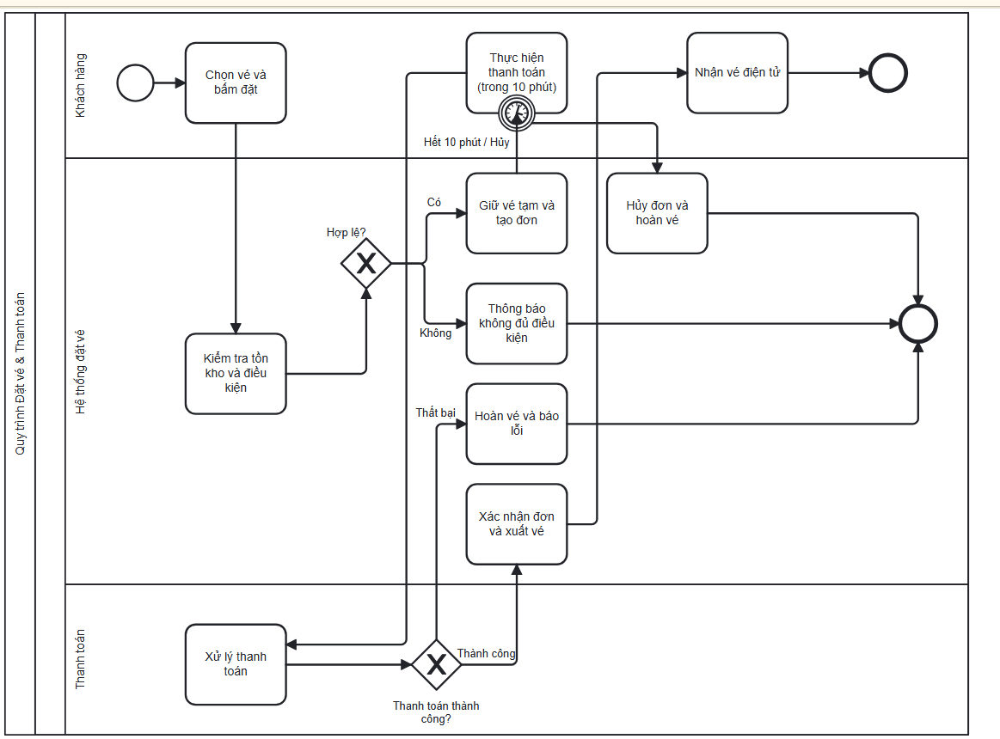
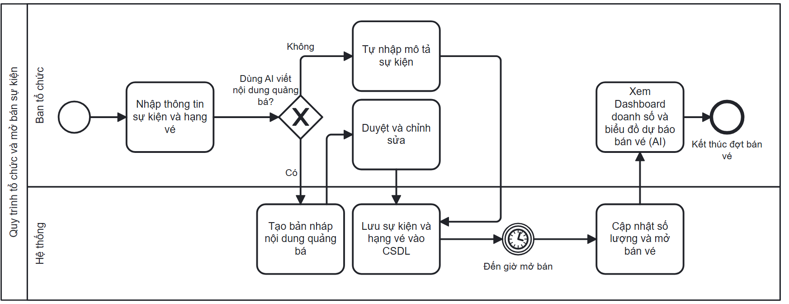

1. Khảo sát hệ thống bán vé có thật

| Tiêu chí khảo sát | Ticketbox (Việt Nam) | Ticketmaster (Quốc tế) | Eventbrite (Quốc tế) |
| :---- | :---- | :---- | :---- |
| Quy trình mua vé | Đăng nhập → Chọn sự kiện → Vào phòng chờ (nếu show lớn) → Chọn hạng vé/số lượng → Điền thông tin → Thanh toán → Nhận vé điện tử | Đăng nhập → Vào phòng chờ (Smart Queue) → Chọn ghế/hạng vé → Xác nhận đơn → Thanh toán → Nhận vé điện tử (SafeTix). | Chọn sự kiện → Chọn hạng vé & số lượng → Điền thông tin đăng ký → Thanh toán (hỗ trợ mua trực tiếp không cần tạo tài khoản trước) → Nhận vé qua email/app. |
| Thời gian giữ vé (TTL) | 10 – 15 phút/lượt (tùy sự kiện; thường 10 phút giữ vé và 5 phút thanh toán). Hết hạn hệ thống tự động giải phóng vé về kho. | Thường 8 – 10 phút (đếm ngược trên màn hình checkout). Hết thời gian, ghế/vé tự động trả lại kho. | Mặc định 20 phút (theo Eventbrite Help Center), nhưng cho phép Ban tổ chức tự tùy chỉnh rút ngắn xuống (ví dụ 8–10 phút) cho các sự kiện có nhu cầu cao. |
| Giới hạn vé/người | Do BTC quy định theo từng sự kiện, phổ biến 4 – 6 vé/giao dịch (một số show nhỏ cho tối đa 10 vé). | Phổ biến 4 – 8 vé/tài khoản (kiểm soát chặt theo tài khoản, thẻ thanh toán và địa chỉ để chống phe vé). | Do BTC tự cấu hình linh hoạt theo từng hạng vé (có thể đặt min/max số vé mỗi đơn hàng). |
| Cơ chế hàng chờ | Có phòng chờ ảo (Waiting Room) cấp số thứ tự khi mở bán các concert lớn (nhưng vẫn dễ nghẽn ở cổng vào). | Có Smart Queue (hàng chờ thông minh tích hợp xác thực tài khoản/chống bot trước khi vào chọn vé). | Không dùng hàng chờ ảo mặc định (chủ yếu phục vụ sự kiện vừa và nhỏ, hội thảo); thay vào đó có tính năng Waitlist (danh sách chờ khi đã bán hết vé). |
| Sự cố khi mở bán nóng | Sập web/app thực tế: Mở bán concert Anh Trai Vượt Ngàn Chông Gai (12/11/2024 và 21/01/2025) bị sập ngay sau vài giây do lượng truy cập khủng (\>150.000 người xếp hàng – nguồn: VOV, Lao Động, CafeF); trước đó từng sập khi bán vé Blackpink Born Pink (2023). | Sập hệ thống thực tế: Đợt mở bán Taylor Swift – The Eras Tour tại Mỹ (11/2022) và Singapore (07/2023) bị sập trang chủ, báo lỗi "Rate exceeded", văng khỏi hàng chờ hoặc lỗi ở bước thanh toán (nguồn: Channel NewsAsia, Ticketmaster). | Ít ghi nhận sự cố sập diện rộng do phân khúc sự kiện nhỏ/phân tán hơn; Eventbrite công bố mức độ sẵn sàng (uptime) đạt 99,99%. |
| Chatbot / Hỗ trợ | Chủ yếu là Trung tâm trợ giúp (FAQ tĩnh), email và hotline CSKH; chưa có chatbot AI hỏi đáp tự động theo từng sự kiện. | Có trợ lý hỗ trợ ảo xử lý các câu hỏi đơn hàng cơ bản; gần đây mở rộng tích hợp khám phá sự kiện qua các nền tảng AI (ChatGPT, Gemini, Claude). | Chủ yếu là Help Center (FAQ) và chat hỗ trợ cho nhà tổ chức gói trả phí; chưa có chatbot AI hỏi đáp chính sách trực tiếp cho từng sự kiện của người mua. |
| Gợi ý sự kiện | Có: Gợi ý theo danh mục (nhạc sống, sân khấu, thể thao), địa điểm (TP.HCM, Hà Nội) và sự kiện xu hướng. | Có: Gợi ý cá nhân hóa dựa trên nghệ sĩ yêu thích, lịch sử xem/mua và vị trí địa lý. | Có: Gợi ý sự kiện trên marketplace dựa trên danh mục quan tâm, lịch sử tương tác và vị trí. |
| Công cụ AI cho BTC | Chủ yếu là Dashboard thống kê doanh số/check-in truyền thống; chưa tích hợp AI sinh nội dung hay dự báo bán vé. | Tập trung vào phân tích dữ liệu chuyên sâu và định giá động (Dynamic Pricing) theo nhu cầu thị trường. | Có tích hợp AI cho BTC: Công cụ AI tự động viết mô tả sự kiện, gợi ý thẻ (tags), danh mục và soạn nội dung email/quảng cáo (giúp giảm \~30% thời gian tạo sự kiện theo Eventbrite). |

2. Khảo sát nhanh người từng mua vé online  
   2.1. Mục đích khảo sát  
   Khảo sát được thực hiện nhằm tìm hiểu trải nghiệm mua vé sự kiện trực tuyến, các sự cố thường gặp và nhu cầu sử dụng những chức năng AI hỗ trợ người dùng. Kết quả được sử dụng làm cơ sở phân tích yêu cầu cho hệ thống quản lý và đặt vé sự kiện trực tuyến.  
   2.2. Kết quả khảo sát  
   Khảo sát thu được 20 phản hồi, trong đó 18 người (90%) đã từng mua vé sự kiện trực tuyến và 2 người chưa từng sử dụng dịch vụ này.  
   2.1. Các sự cố khi đặt vé  
   Trong 18 người từng mua vé, kết quả ghi nhận:

| Sự cố gặp phải | Số người | Tỷ lệ |
| :---: | :---: | :---: |
| Website bị sập hoặc treo | 11 | 61,1% |
| Mất kết nối khi thanh toán | 10 | 55,6% |
| Báo hết vé dù vừa thấy còn | 8 | 44,4% |
| Bị trừ tiền hoặc đặt trùng | 6 | 33,3% |

   Kết quả cho phép chọn nhiều đáp án nên tổng tỷ lệ có thể vượt 100%.

   2.2. Nhu cầu ứng dụng AI

   Trong 18 người đã từng mua vé và trả lời nhóm câu hỏi về AI:

- 100% mong muốn sử dụng chatbot AI để giải đáp thông tin sự kiện, giá vé và chính sách.  
- 66,7% đánh giá chức năng gợi ý sự kiện theo sở thích là rất cần thiết.  
- 33,3% cho rằng có chức năng gợi ý sự kiện sẽ tốt hơn.

          2.3. Mong muốn cải thiện hệ thống

- Các ý kiến tự do chủ yếu tập trung vào việc cải thiện tốc độ đặt vé, hạn chế giật                                                 lag, tránh lỗi khi nhiều người truy cập đồng thời và xây dựng giao diện đơn giản, dễ sử dụng.  
- Người dùng cũng quan tâm đến giá vé, phương thức thanh toán, độ tin cậy và tính ổn định của quá trình đặt vé.  
3. Vẽ BPMN  
   3.1. Quy trình đặt vé và thanh toán  
     
     
     
     
     
   3.2. Quy trình tổ chức và mở bán sự kiện  
   

4. Thí nghiệm "tái hiện lỗi"

Kết quả thí nghiệm tái hiện lỗi Overbooking

Thí nghiệm sử dụng ASP.NET Core, PostgreSQL và công cụ Locust để mô phỏng 500 người dùng ảo thực hiện yêu cầu đặt vé trong điều kiện hệ thống chỉ có 100 vé.

API được xây dựng theo phương pháp đọc và cập nhật số lượng vé bằng hai câu lệnh SQL riêng biệt, không có cơ chế đồng bộ phù hợp.

Bảng kết quả kiểm thử

| Chỉ tiêu | Kết quả |
| ----- | ----- |
| Số vé phát hành | 100 |
| Tổng yêu cầu đặt vé | 500 |
| Số yêu cầu bị Locust ghi nhận lỗi | 0 |
| Thông lượng trung bình | 117,56 RPS |
| Thời gian phản hồi trung bình | 1.331,53 ms |
| Thời gian phản hồi p95 | 2.200 ms |
| Số vé đã bán ghi nhận trong PostgreSQL | 300 |
| Số vé bán vượt | 200 |

Nhận xét thí nghiệm:

Kết quả kiểm tra cơ sở dữ liệu ghi nhận 300 vé đã bán, vượt 200 vé so với số lượng phát hành ban đầu. Điều này chứng minh lỗi Overbooking đã xảy ra trong hệ thống thử nghiệm.

Nguyên nhân là các yêu cầu đồng thời có thể đọc cùng một trạng thái tồn kho trước khi dữ liệu được cập nhật. Câu lệnh cập nhật không kiểm tra lại giới hạn số vé, dẫn đến việc bán vượt số lượng cho phép.

Kết quả là cơ sở thực nghiệm để nghiên cứu các giải pháp kiểm soát truy cập đồng thời ở những giai đoạn tiếp theo của đồ án.

 

