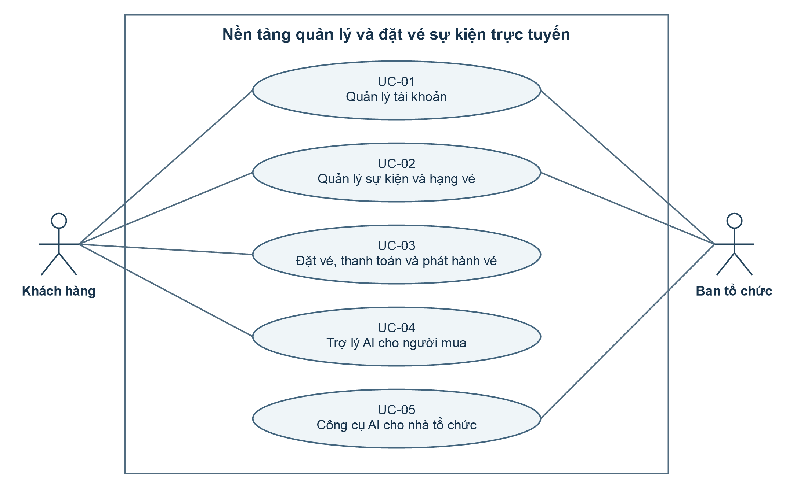

# Tuần 2 – Phân tích yêu cầu của nền tảng đặt vé sự kiện

Người mua cần biết mình đã giữ được bao nhiêu vé, còn bao lâu để thanh toán và khi nào có thể nhận vé. Ban tổ chức cần kiểm soát số lượng mở bán, theo dõi doanh số và duyệt nội dung quảng bá. Phạm vi đồ án gồm hai vai trò này, bán vé theo hạng, thanh toán giả lập và bốn chức năng AI chạy cục bộ. Báo cáo trình bày yêu cầu chức năng (FR), yêu cầu phi chức năng (NFR) và sơ đồ Use Case (UC) theo mục Tuần 2 của *Đề cương chi tiết*.

## 1. Căn cứ từ Tuần 1

| Bằng chứng đã ghi nhận | Yêu cầu rút ra |
| --- | --- |
| Trong 20 người trả lời khảo sát, 18 người từng mua vé trực tuyến. Trong nhóm 18 người, 10 người gặp mất kết nối khi thanh toán và 6 người chọn phương án “bị trừ tiền hoặc đặt trùng”. | Khách cần tra cứu được trạng thái đơn sau khi kết nối lại. Gửi lại cùng yêu cầu đặt vé phải dẫn về cùng một đơn. [Báo cáo khảo sát](../week-01/week-1.md) |
| Trong thí nghiệm với 500 yêu cầu và 100 vé phát hành, Locust ghi nhận 0 yêu cầu lỗi. PostgreSQL ghi nhận 300 vé đã bán, vượt 200 vé. | NFR-1 phải kiểm tra số lượng vé trong dữ liệu nghiệp vụ. NFR-5 đo lỗi phản hồi ở phía gửi yêu cầu. Cần cả hai phép đo để đánh giá một lần mở bán. [Kết quả đối soát](../../experiments/week-01-overbooking/results/README.md) · [CSV Locust](../../experiments/week-01-overbooking/results/week1-retest_stats.csv) |
| Cả 18 người từng mua vé đều muốn có chatbot. Ba lượt thử tiếng Việt với mô hình 0,5B trên CPU mất từ 1,456 đến 4,099 giây. Ở câu hỏi về vé điện tử, mô hình trả lời sang chủ đề tiền điện tử. | Chatbot cần trả lời dựa trên tài liệu sự kiện và dẫn nguồn. NFR-11 đo riêng độ đúng và thời gian trả lời trên bộ 50 câu. [Kết quả khảo sát và nhận xét](../week-01/week-1.md) · [Nhật ký Ollama](../experiments/week-01-ollama.txt) |

## 2. Yêu cầu chức năng

Mỗi dòng mô tả một hành vi và dấu hiệu có thể dùng để nghiệm thu. Cột UC liên kết yêu cầu với sơ đồ ở mục 4. Mức ưu tiên dùng MoSCoW. **Must** là bắt buộc, **Should** là quan trọng nhưng có thể làm sau phần bắt buộc, **Could** là phần có thể rút gọn khi thiếu thời gian. **Won’t** áp dụng cho phần ngoài phạm vi, chẳng hạn thanh toán thật và chọn từng ghế. Theo thứ tự ưu tiên của đề cương, giữ chức năng chatbot, gợi ý và sinh bản nháp quảng bá cơ bản, còn dự báo bán vé ở mức Should.

### 2.1. Khách hàng

| Mã | Yêu cầu | Ưu tiên | UC | Tiêu chí chấp nhận |
| --- | --- | --- | --- | --- |
| FR-01 | Đăng ký tài khoản khách hàng | Must | UC-01 | Thông tin đăng ký hợp lệ tạo được một tài khoản có vai trò Khách hàng và có thể dùng để đăng nhập. |
| FR-02 | Đăng nhập | Must | UC-01 | Tài khoản hợp lệ truy cập được chức năng đúng vai trò. Thông tin đăng nhập sai bị từ chối. Tiêu chí này cũng áp dụng cho tài khoản Ban tổ chức. |
| FR-03 | Xem danh sách sự kiện | Must | UC-02 | Khách thấy các sự kiện được công bố và mở được trang của sự kiện đã chọn. |
| FR-04 | Tìm sự kiện theo tên | Must | UC-02 | Từ khóa khớp trả về sự kiện tương ứng. Khi không có kết quả, giao diện thông báo cho khách. |
| FR-05 | Xem chi tiết sự kiện | Must | UC-02 | Trang chi tiết hiển thị thời gian, địa điểm, giờ mở bán, hạng vé và giá tương ứng với sự kiện đã chọn. |
| FR-06 | Chọn hạng vé và số lượng | Must | UC-03 | Trước khi xác nhận, khách thấy đúng hạng vé, số lượng và thành tiền bằng đơn giá nhân số lượng. |
| FR-07 | Gửi yêu cầu đặt vé | Must | UC-03 | Yêu cầu hợp lệ được tiếp nhận và có mã để tra cứu. Nếu không thể giữ vé, khách nhận được lý do tương ứng. |
| FR-08 | Theo dõi trạng thái đơn | Must | UC-03 | Khách mở lại đơn của mình sau khi tải lại trang và thấy trạng thái hiện tại. Đơn đang chờ thanh toán hiển thị thời gian giữ còn lại. |
| FR-09 | Thanh toán giả lập cho đơn đang giữ | Must | UC-03 | Với đơn còn hiệu lực, khách có thể thanh toán và xem kết quả thành công hoặc thất bại của lần thanh toán đó. |
| FR-10 | Xem vé đã phát hành | Must | UC-03 | Trong mục vé của mình, khách thấy đúng sự kiện, hạng và mã của từng vé thuộc đơn đã phát hành. |
| FR-11 | Hủy đơn đang chờ thanh toán | Must | UC-03 | Khách xác nhận hủy đơn của mình khi còn chờ thanh toán. Khi mở lại, đơn hiển thị trạng thái đã hủy. |
| FR-12 | Hỏi chatbot về sự kiện, vé và chính sách | Must | UC-04 | Với câu hỏi có đáp án trong tài liệu, chatbot trả lời bằng tiếng Việt và nêu nguồn để khách đối chiếu. |
| FR-13 | Hỏi chatbot về giá và lượng vé còn hiện tại | Must | UC-04 | Khi giá hoặc tồn kho thay đổi trước lúc hỏi, câu trả lời khớp với dữ liệu sự kiện tại thời điểm truy vấn. |
| FR-14 | Nhận phản hồi khi chatbot thiếu căn cứ | Must | UC-04 | Với câu hỏi ngoài phạm vi hoặc thiếu tài liệu, chatbot cho biết giới hạn thông tin và hướng khách liên hệ ban tổ chức. |
| FR-15 | Xem gợi ý sự kiện cá nhân hóa | Must | UC-04 | Khách có lịch sử tương tác thấy danh sách gợi ý. Các sự kiện khách đã mua, đã diễn ra hoặc hết vé được loại khỏi danh sách. |
| FR-16 | Xem gợi ý khi mới tham gia | Must | UC-04 | Tài khoản chưa có lịch sử mua nhận được gợi ý theo sở thích ban đầu hoặc sự kiện phổ biến theo thành phố khi có dữ liệu phù hợp. |

### 2.2. Ban tổ chức

| Mã | Yêu cầu | Ưu tiên | UC | Tiêu chí chấp nhận |
| --- | --- | --- | --- | --- |
| FR-17 | Tạo sự kiện | Must | UC-02 | Sau khi nhập thông tin hợp lệ, ban tổ chức mở lại được sự kiện với đúng tên, thời gian, địa điểm và mô tả đã lưu. |
| FR-18 | Sửa thông tin sự kiện | Must | UC-02 | Thông tin đã sửa xuất hiện khi mở lại sự kiện. Trang chi tiết của sự kiện đã công bố phản ánh nội dung mới. |
| FR-19 | Khai báo hạng vé | Must | UC-02 | Một sự kiện có thể có nhiều hạng vé. Mỗi hạng có tên và giá riêng, hiển thị đúng trên trang sự kiện. |
| FR-20 | Khai báo số vé phát hành theo hạng | Must | UC-02 | Trước khi mở bán, ban tổ chức đặt được số lượng cho từng hạng. Số lượng của hạng này được ghi nhận độc lập với hạng khác. |
| FR-21 | Ấn định giờ mở bán | Must | UC-02 | Giờ đã lưu xuất hiện trên trang sự kiện. Khách có thể bắt đầu đặt khi đến giờ theo đồng hồ máy chủ. |
| FR-22 | Xem thống kê bán vé theo sự kiện | Must | UC-02 | Số vé bán theo từng hạng khớp với số vé của các đơn đã thanh toán. Đơn đang giữ được phân biệt với vé đã bán. |
| FR-23 | Sinh bản nháp mô tả sự kiện | Must | UC-05 | Từ thông tin do ban tổ chức nhập, AI tạo được bản mô tả tối đa 150 từ, giữ đúng thời gian và địa điểm đã cung cấp. |
| FR-24 | Sinh thêm nội dung quảng bá | Could | UC-05 | Ban tổ chức chọn được loại bản nháp. Loại tiêu đề trả về ba phương án. Loại bài đăng hoặc thư thông báo tạo văn bản tương ứng từ cùng dữ liệu sự kiện. |
| FR-25 | Duyệt và sửa bản nháp do AI tạo | Must | UC-05 | Nội dung công bố chỉ thay đổi khi ban tổ chức xác nhận lưu. Nếu đã chỉnh sửa, nội dung lưu trùng với bản vừa duyệt. |
| FR-26 | Xem dự báo bán vé | Should | UC-05 | Với sự kiện có lịch sử bán, ban tổ chức xem được dự báo số vé bán trong 7 ngày tới và ngày dự kiến hết vé nếu có căn cứ ước tính. |
| FR-27 | Nhận cảnh báo bán chậm | Should | UC-05 | Khi tốc độ bán thấp hơn mức kỳ vọng dùng cho sự kiện, màn hình dự báo hiển thị cảnh báo gắn đúng sự kiện. |

Với FR-23 đến FR-25, mục 0.6 và 4.7 của đề cương còn yêu cầu đánh giá chất lượng bản nháp. Ít nhất 5 người chấm độ chính xác và độ tự nhiên trên thang 1–5, với mục tiêu trung bình ≥ 3,5/5 cho mỗi tiêu chí. Người chấm đối chiếu bản nháp với dữ liệu đầu vào để ghi riêng trường hợp AI tự thêm giá, thời gian, địa điểm hoặc khuyến mãi.

### 2.3. Hệ thống

Các yêu cầu dưới đây là hành vi tự động xảy ra khi phục vụ người dùng. Hệ thống được biểu diễn bằng khung bao quanh các Use Case trong sơ đồ.

| Mã | Yêu cầu | Ưu tiên | UC | Tiêu chí chấp nhận |
| --- | --- | --- | --- | --- |
| FR-28 | Kiểm tra giờ mở bán khi nhận yêu cầu | Must | UC-03 | Yêu cầu đến trước giờ được từ chối với lý do chưa mở bán. Số vé khả dụng giữ nguyên. |
| FR-29 | Kiểm tra giới hạn vé mỗi khách | Must | UC-03 | Nếu số vé đang giữ và đã mua của khách cộng với lượng yêu cầu vượt giới hạn áp dụng cho sự kiện, hệ thống từ chối lượt đặt đó. |
| FR-30 | Kiểm tra số vé còn theo hạng | Must | UC-03 | Nếu hạng vé còn ít hơn số lượng yêu cầu, hệ thống thông báo thiếu vé và giữ nguyên tồn kho. |
| FR-31 | Nhận biết yêu cầu đặt gửi lại | Must | UC-03 | Cùng khách gửi lại cùng yêu cầu với cùng mã chống trùng (idempotency key) nhận lại kết quả của lượt đặt ban đầu. Kho chỉ bị trừ một lần. |
| FR-32 | Giữ vé có thời hạn | Must | UC-03 | Khi chấp nhận giữ vé, hệ thống trừ đúng số lượng khả dụng của hạng và gắn thời điểm hết hạn cho lượt giữ. |
| FR-33 | Kết thúc lượt giữ quá hạn | Must | UC-03 | Đơn còn chờ thanh toán khi qua hạn chuyển sang hết hạn. Yêu cầu thanh toán đến sau hạn bị từ chối. |
| FR-34 | Hoàn đúng số vé đã giữ | Must | UC-03 | Khi đơn hết hạn, bị hủy hoặc thanh toán thất bại, kho của đúng hạng tăng lại đúng số lượng một lần. Khách khác có thể đặt số vé vừa hoàn. |
| FR-35 | Ghi nhận thanh toán thành công | Must | UC-03 | Một xác nhận thành công cho đơn còn hiệu lực chuyển số vé từ đang giữ sang đã thanh toán. Xác nhận lặp lại giữ nguyên số vé đã thanh toán. |
| FR-36 | Phát hành vé điện tử | Must | UC-03 | Đơn thanh toán thành công có đúng số vé đã mua, mỗi vé một mã duy nhất. Đơn thanh toán thất bại có 0 vé phát hành. |
| FR-37 | Thông báo khi trợ lý AI tạm ngưng | Must | UC-04 | Khi AI quá tải hoặc ngừng phục vụ, khách thấy thông báo ở khu vực trợ lý và vẫn có thể gửi yêu cầu đặt vé. |

## 3. Yêu cầu phi chức năng và cách đo

Các giá trị dưới đây là **mục tiêu nghiệm thu cho các tuần kiểm thử**. Kịch bản mở bán T2 trong đề cương dùng một sự kiện có 1.000 vé và 20.000 người dùng ảo tăng dần trong 10–30 giây, sau đó cùng gửi yêu cầu đặt vé. Khi đo hiệu năng, ghi cấu hình CPU/RAM của máy chạy hệ thống và máy Locust, phiên bản phần mềm, số bản sao, thời gian đo và số lần lặp. Khi so sánh hai lần chạy, giữ cùng dữ liệu ban đầu và cùng lịch phát tải.

| Mã | Yêu cầu và chỉ tiêu mục tiêu | Công cụ, dữ liệu và cách đo | Nơi lấy minh chứng |
| --- | --- | --- | --- |
| NFR-1 | **Không bán vượt.** 0 vé vượt ở từng hạng trong mọi lần thử. Với T2 đủ nhu cầu và còn trong hạn giữ, tổng số vé được cấp phải đúng 1.000. | Locust tạo tải. Tại cùng mốc đối soát, dùng SQL cộng số lượng đã thanh toán (kể cả đơn đã phát hành) và số đang giữ còn hạn theo từng hạng. So với lượng phát hành ban đầu, tránh đếm hai lần một vé. | Kết quả SQL trên các shard PostgreSQL của sự kiện, bảng số lượng ban đầu và mã lần chạy. |
| NFR-2 | **Không đặt trùng.** 0 mã chống trùng sinh nhiều đơn và 0 lần trừ kho thêm do gửi lại. | T3 dùng Locust gửi ba lần cùng yêu cầu và cùng khóa cho mỗi khách. Đối chiếu các mã đặt trả về, số đơn theo khóa và chênh lệch tồn kho của nhóm yêu cầu hợp lệ. | Nhật ký yêu cầu, kết quả nhóm đơn bằng SQL trên các shard và số lượng vé trước/sau thử nghiệm. |
| NFR-3 | **Thông lượng đặt vé.** Mục tiêu ≥ 1.000 yêu cầu/giây (RPS) trên máy thử. | Trong T2, đếm yêu cầu hoàn tất của riêng `POST /bookings` trong từng cửa sổ 1 giây. Đối chiếu RPS đỉnh với mục tiêu, ghi thêm RPS trung bình toàn lượt và tách kết quả nhận đặt/hết vé. | Thời điểm hoàn tất và kết quả từng yêu cầu phía Locust, bảng RPS theo giây, cấu hình máy thử. |
| NFR-4 | **Độ trễ đặt vé.** p95 < 500 ms và p99 < 1.500 ms. | Trong T2, Locust đo từ lúc gửi yêu cầu đặt đến lúc nhận phản hồi API. Đọc phân vị 95 và 99 của riêng API đặt vé cho cùng khoảng đo. | Dòng `POST /bookings` trong CSV thống kê Locust. |
| NFR-5 | **Lỗi hệ thống.** Dưới 1% yêu cầu đặt vé gặp lỗi máy chủ hoặc hết thời gian chờ. | Trong T2, chia số yêu cầu nhận HTTP 5xx hoặc timeout cho tổng yêu cầu đặt rồi nhân 100%. Phản hồi hết vé là kết quả nghiệp vụ hợp lệ. | Bảng phân loại mã phản hồi, thống kê timeout và CSV lỗi của Locust. |
| NFR-6 | **Thời hạn giữ vé.** Giữ 10 phút và hoàn kho trong ≤ 30 giây sau hạn. | Trong T4, cho 500 khách giữ vé đến hết hạn. Đối chiếu hạn giữ với mốc giữ thành công cộng 600 giây. Với từng đơn, lấy thời điểm kho tăng lại trừ hạn giữ. Kiểm tra khách kế tiếp mua được vé vừa hoàn. | Dấu thời gian phía máy chủ theo mã đơn, lịch sử hoàn kho và kết quả đặt kế tiếp. |
| NFR-7 | **Chịu lỗi.** Khi tắt 1 bản sao đặt vé, các bản sao còn lại vẫn trả kết quả nghiệp vụ trong thời gian bản sao đó dừng. | Trong T6, chạy ít nhất 2 bản sao rồi dừng 1 bản khi T2 đang có tải. Đếm phản hồi đặt vé hợp lệ từ bản sao còn lại trong khoảng dừng, ghi tỉ lệ lỗi và khoảng gián đoạn dài nhất. | Sự kiện dừng pod của Kubernetes, log theo bản sao và dòng thời gian phản hồi Locust. |
| NFR-8 | **Khả năng mở rộng.** RPS tăng khi tăng số bản sao đặt vé. | Trong T5, lặp T2 với 1, 3 rồi 5 bản sao. Dùng cùng cách tính RPS ở NFR-3 và so sánh RPS đỉnh giữa từng cặp cấu hình, kèm p95 và tỉ lệ lỗi. | Bảng so sánh của Locust theo số bản sao và bản ghi cấu hình mỗi lượt. |
| NFR-9 | **Bảo mật.** 0 lượt chấp nhận JWT thiếu/hết hạn trên tài nguyên riêng, 0 lần lộ đơn của khách khác. Yêu cầu vượt hạn mức bị giới hạn. | Dùng xUnit và hai tài khoản thử có đơn riêng. Kiểm tra yêu cầu có JWT hợp lệ của chủ đơn, thiếu JWT, JWT hết hạn và truy cập chéo. Với hạn mức đã cấu hình, gửi quá số cho phép trong cùng cửa sổ, đối chiếu phản hồi 429. | Báo cáo xUnit, cấu hình hạn mức tại Gateway, mã phản hồi và kiểm tra nội dung trả về của API. |
| NFR-10 | **Cô lập AI.** Đặt vé vẫn phục vụ khi AI quá tải hoặc tắt. Ngưỡng đề xuất là RPS giảm ≤ 10% và p95 tăng ≤ 10% so với T2. | Dùng T2 làm mốc. Lặp với 20 khách ảo hỏi chatbot liên tục (T8), rồi với dịch vụ AI và Ollama bị tắt giữa lượt (T9). So sánh RPS và p95 ở cùng giai đoạn tải, tính chênh lệch theo phần trăm so với mốc. | CSV Locust của T2/T8/T9 cho riêng đặt vé, mốc bắt đầu tải và thời điểm tắt AI. |
| NFR-11 | **Chatbot.** Đúng ≥ 35/50 câu (70%). Nhóm 10 câu ngoài phạm vi phải được từ chối đúng. Ghi p95 thời gian trả lời, mốc tham khảo trên CPU là < 20 giây. | Chấm tay 30 câu dựa trên tài liệu, 10 ngoài phạm vi và 10 câu cần dữ liệu hiện tại. Đối chiếu với đáp án, nguồn và dữ liệu sự kiện lúc hỏi. Một lời từ chối đúng ở nhóm ngoài phạm vi được tính đúng. Đo từ lúc gửi đến khi nhận trọn câu trả lời. | Bảng chấm từng câu, nguồn, số câu từ chối đúng trên 10, nhật ký thời gian, phiên bản mô hình và cấu hình máy. |
| NFR-12 | **Gợi ý.** Cả Precision@5 và HitRate@10 cao hơn cách xếp sự kiện phổ biến nhất. | Trên dữ liệu tương tác tổng hợp, giữ lại lần mua cuối của từng khách đủ lịch sử làm đáp án. Dùng cùng danh sách sự kiện hợp lệ cho hai cách. Chỉ dùng dữ liệu có trước thời điểm dự đoán để xếp hạng. Tính tỉ lệ mục đúng trong top 5 và tỉ lệ khách có đáp án trong top 10. | Bảng xếp hạng theo khách, danh sách lượt mua giữ lại và bảng so sánh hai chỉ số. |
| NFR-13 | **Dự báo.** MAE và MAPE trên tập kiểm tra thấp hơn phương pháp lặp lại lượng bán ở kỳ gần nhất. | Tách chuỗi bán vé tổng hợp theo thời gian, dùng phần sớm để huấn luyện và phần muộn để đánh giá cùng kỳ dự báo 7 ngày. Tính sai số tuyệt đối trung bình (MAE) trên mọi điểm. Với sai số phần trăm tuyệt đối trung bình (MAPE), dùng cùng tập điểm có lượng bán thực tế lớn hơn 0 và ghi số điểm bị loại. | Bảng theo sự kiện/ngày gồm lượng bán mô phỏng, dự báo của hai phương pháp, mốc chia tập và hai chỉ số. |
| NFR-14 | **Chi phí và nơi chạy.** 100% thành phần cần để vận hành chạy trên máy cá nhân với chi phí phần mềm/dịch vụ bắt buộc bằng 0. | Đối chiếu danh mục phần mềm và mô hình với điều kiện sử dụng trong đồ án. Sau khi cài đủ tài nguyên, chạy thử đặt vé và các chức năng AI trên máy cục bộ khi ngắt Internet. | Danh mục phiên bản và nguồn giấy phép, cấu hình địa chỉ dịch vụ, nhật ký và kết quả chạy cục bộ. |

Đề cương dùng cụm “không bị ảnh hưởng đáng kể” cho NFR-10. Hai ngưỡng 10% là đề xuất để giảng viên và sinh viên thống nhất trước khi đo. Với NFR-11, ba lượt Ollama ở Tuần 1 cung cấp mốc tham khảo cho máy cá nhân. Bộ 50 câu và phép đo toàn bộ thời gian trả lời của chatbot sẽ được thực hiện ở giai đoạn đánh giá AI.

## 4. Sơ đồ Use Case tổng quát

| Use Case | Tác nhân | Phạm vi của tác nhân |
| --- | --- | --- |
| UC-01 · Quản lý tài khoản | Khách hàng, Ban tổ chức | Khách đăng ký và đăng nhập. Ban tổ chức đăng nhập bằng tài khoản được cấp. |
| UC-02 · Quản lý sự kiện và hạng vé | Khách hàng, Ban tổ chức | Khách xem hoặc tìm thông tin đã công bố. Ban tổ chức tạo, sửa, cấu hình mở bán và xem thống kê. |
| UC-03 · Đặt vé, thanh toán và phát hành vé | Khách hàng | Khách đặt, theo dõi, thanh toán giả lập, xem vé hoặc hủy đơn đang giữ. Hệ thống xử lý giữ, hoàn và phát hành vé. |
| UC-04 · Trợ lý AI cho người mua | Khách hàng | Khách hỏi chatbot về sự kiện, chính sách, tình trạng vé và xem gợi ý phù hợp. |
| UC-05 · Công cụ AI cho nhà tổ chức | Ban tổ chức | Ban tổ chức tạo và duyệt nội dung quảng bá, xem dự báo bán vé và cảnh báo bán chậm. |

Các đường nối thể hiện vai trò tham gia. Quyền xem của khách và quyền chỉnh sửa của ban tổ chức được phân biệt trong UC-02. [Mở bản sơ đồ để chỉnh sửa bằng draw.io](images/use-case-tong-quat.drawio)
